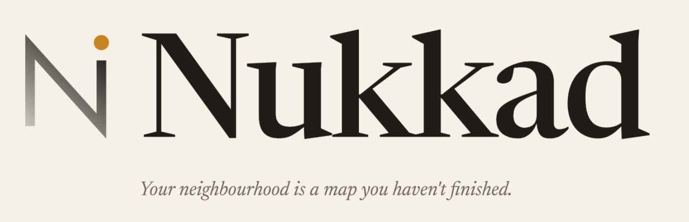
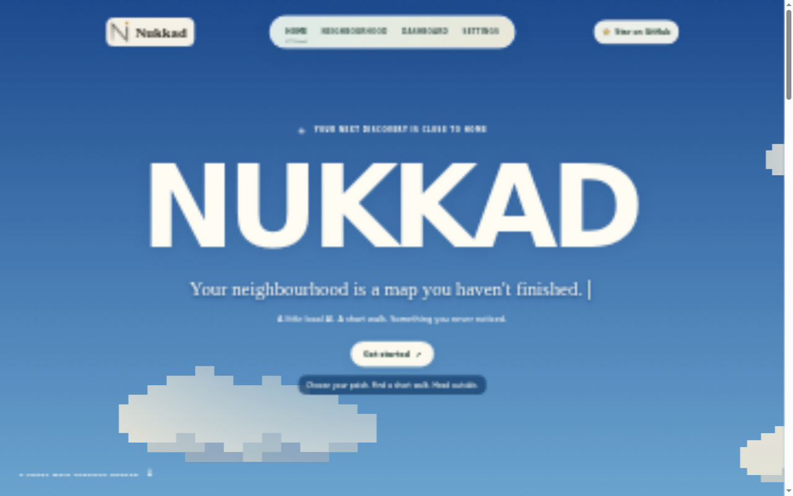

<p align="center">
  
</p>

# Nukkad

A little local AI. A short walk. Something you never noticed.

Nukkad helps you discover the neighbourhood around you. Give it your interests and 20–60 minutes; it suggests nearby stops and prepares a return walk. Take the exported card outside on your phone or on paper, then bring back an observation, a story or a photo.



## What you can do

- **Explore nearby:** find your neighbourhood by name, save its OpenStreetMap data and confirm a public walking start.
- **Plan a short walk:** choose Wander or Seek, review the route and export a phone image or printable card.
- **Keep place memories:** report a visit from the map or after a walk, write an experience and add up to five photos per visit.
- **Build your notebook:** revisit walks and place folders in Dashboard, with editable Location Cards, longer journals and earlier versions.

## How local AI helps

**Gemma 4 E2B runs through Ollama on your laptop.** It ranks eligible stops using your interests and reviewed context, writes observation activities, drafts third-person journals and helps prepare photo-backed Location Cards. You can select another installed local model in Settings.

Application code checks walking paths, the return journey, time, distance and daylight constraints. AI results and fallbacks are labelled, and inferred interests require your review. Visits are self-reported; map data cannot guarantee current access or safety.

Notes, photos and inference stay on your laptop. Initial location searches, map downloads and installation require internet; prepared maps and installed weights support offline use. No paid inference API is required.

## Run locally

Install **Python 3.12**, **Git**, [uv](https://docs.astral.sh/uv/getting-started/installation/) and [Ollama](https://ollama.com/). PNG export also needs Cairo and DejaVu Sans fonts; see the [setup guide](docs/setup.md) for platform requirements.

With Ollama running locally:

```sh
git clone https://github.com/Yajush-afk/Nukkad.git
cd Nukkad
uv sync --locked
ollama pull gemma4:e2b
uv run nukkad serve --port 8001
```

Open **http://localhost:8001** and choose **Get started**. Nukkad is a local application with a browser interface; your phone receives an exported card.

[Setup and first walk](docs/setup.md) · [Project guides](docs/README.md) · [Backup and recovery](docs/operations.md)

## Built with

Python, FastAPI, SQLite, OSMnx, NetworkX, Leaflet, Ollama and Gemma. The interface uses HTML, CSS and JavaScript with bundled assets.

Created by **Yajush Srivastava** for the DEV Hacktoberfest **Touch Grass** challenge.

Application code: [MIT](LICENSE). Map data: [© OpenStreetMap contributors](https://www.openstreetmap.org/copyright). Model weights are downloaded separately and retain their own licences; see [licensing and credits](docs/licensing.md).
